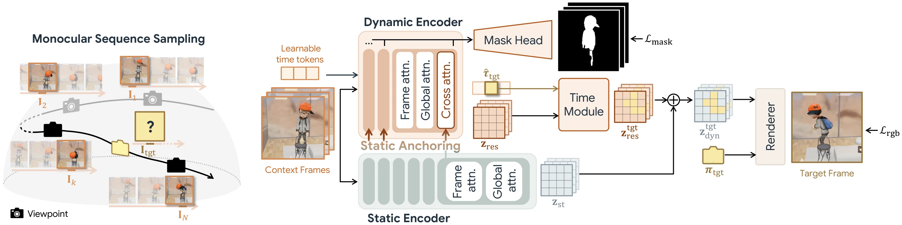

<div align="center">


### Feed-forward Latent Model for 4D Novel View Synthesis

<p align="center">
  <a href="https://cvlab-kaist.github.io/FL4N/"></a>
  <a href="https://arxiv.org/abs/2610.35854"></a>
  <a href="https://huggingface.co/eunbeen-hong/FL4N"></a>
</p>

This is the official implementation of the paper **"FL4N: Feed-forward Latent Model for 4D Novel View Synthesis"** by
[Eunbeen Hong](https://eunbeen-hong.github.io/)<sup>1</sup>, [Hyeonseo Yu](https://hdeori.github.io/)<sup>1</sup>, [Honggyu An](https://hg010303.github.io/)<sup>1</sup>, [Jooho Son](https://personal-website-rho-two-13.vercel.app/)<sup>1</sup>, [Hyunah Ko](https://hyunahko.github.io/)<sup>1</sup>, [Soowon Son](https://soow0n.github.io/)<sup>1</sup>, [Chaehyun Kim](https://kchyun.github.io/)<sup>1</sup>, [Jahyeok Koo](https://jahyeok-koo.github.io/)<sup>1</sup>, [Jisoo Kim](https://jiiiisoo.github.io/)<sup>1</sup>, [Junhwa Hur](https://hurjunhwa.github.io/)<sup>2†</sup>, [Seungryong Kim](https://cvlab.kaist.ac.kr/)<sup>1†</sup>.

<sup>1</sup> KAIST AI &nbsp;&nbsp;&nbsp; <sup>2</sup> Google DeepMind

<sub>† Corresponding authors.</sub>

</div>

**FL4N** is the first feed-forward latent 4D NVS model. It renders a dynamic scene from viewpoints and timestamps that were never observed, given one monocular video,
in a single feed-forward pass. Existing feed-forward methods do this with explicit 3D Gaussians plus motion and pay
with ghosting, floaters and holes. FL4N bypasses explicit 4D primitives and keeps the whole scene in one latent
representation across space and time:

- **Frozen static latent prior.** A pretrained static latent NVS backbone supplies the 3D prior, so the model never has
  to learn geometry from the scarce dynamic training data.
- **Dynamic encoder with static anchoring.** A lightweight encoder sees each context frame with a learned time token and
  cross-attends into the frozen static features. It separates true scene motion from camera parallax and outputs a
  time-invariant **temporal residual** latent plus a dynamic mask.
- **Target-time adaptation.** A time module conditions the residual on the target timestamp and adds it to the static
  latent through a zero-initialised gate; the frozen renderer then produces the view. The residual is computed once per
  video, so every further target costs only the time module and the renderer.

<div align="center">

<sub>A frozen static encoder gives the static latent; the dynamic encoder, anchored to it, adds a temporal residual and a dynamic mask; the time module adapts the residual to the target time before the frozen renderer.</sub>
</div>

## ⚡ Quick Start
```bash
git clone https://github.com/cvlab-kaist/FL4N.git
cd FL4N
conda create -n fl4n python=3.11 -y && conda activate fl4n
pip install torch torchvision && pip install -r requirements.txt

# Download the checkpoint
python -c "from huggingface_hub import hf_hub_download; hf_hub_download('eunbeen-hong/FL4N', 'fl4n.ckpt', local_dir='checkpoints')"

# Render one NVIDIA Dynamic Scenes scene (data under $FL4N_DATA/NVIDIA, see Dataset Preparation)
FL4N_DATA=/path/to/data python benchmark/run_eval.py --models fl4n --protocols ctvs --datasets nvidia --scenes Balloon1 --gpus 0
```
Rendered views, a GT/prediction grid and `metrics.json` are written to `benchmark_out/ctvs/nvidia/nvidia/fl4n/Balloon1/`.

## 📁 Dataset Preparation

### Training Datasets
- [**CamxTime**](https://huggingface.co/datasets/zhening/CamxTime) from [SpaceTimePilot](https://github.com/ZheningHuang/SpaceTimePilot); scenes `Scene376`–`Scene417` (the last 10% in sorted order) are held out for testing
- [**Kubric4D**](https://gcd.cs.columbia.edu/) from [GCD](https://github.com/basilevh/gcd)

### Evaluation Datasets
- [**NVIDIA Dynamic Scenes**](https://github.com/gaochen315/DynamicNeRF)
- [**N3DV**](https://github.com/facebookresearch/Neural_3D_Video)

Organize the datasets under one root and point `FL4N_DATA` to it (default `./data`):
```
$FL4N_DATA/
├── CamxTime/
├── Kubric4D/
│   ├── train/
│   └── test/
├── NVIDIA/
├── N3DV/
└── masks/
    ├── camxtime/
    ├── kubric4d_gap4/
    └── kubric4d_gap8/
```

### Dynamic Masks
`masks/` holds flow-based dynamic masks that drive the dynamic-region losses and the mask head: a pixel of frame t is
dynamic where the [WAFT](https://github.com/princeton-vl/WAFT) flow to frame t+gap (t−gap for the last `gap` frames)
exceeds a threshold. Clone WAFT into `third_party/WAFT`, download its `depth-anything-ckpts/` and the a1 adaptation
checkpoint (`checkpoints/waft_a1_adaptation.pth`), then:
```bash
python tools/make_masks.py --dataset camxtime --threshold 0.4 --gap 16 --out $FL4N_DATA/masks/camxtime
python tools/make_masks.py --dataset kubric4d --threshold 5.0 --gap 4  --out $FL4N_DATA/masks/kubric4d_gap4
python tools/make_masks.py --dataset kubric4d --threshold 8.0 --gap 8  --out $FL4N_DATA/masks/kubric4d_gap8
```
Add `--shard i --num-shards N` to split the scenes over N GPUs.

## 🏋️ Train & Inference
For training, place the [LagerNVS base weights](https://huggingface.co/facebook/lagernvs_general_512) at `checkpoints/lagernvs.pt`.
```bash
# Train (all settings are in configs/config.yaml)
python train.py

# Inference on NVIDIA / N3DV
python benchmark/run_eval.py --models fl4n --datasets nvidia --gpus 0
python benchmark/run_eval.py --models fl4n --datasets n3dv --gpus 0
```
```python
from models.checkpoint import load_checkpoint
model, step = load_checkpoint("checkpoints/fl4n.ckpt", "cuda")
out = model(images, rays, cam_token, num_cond_views=K, tau=tau)   # [b, K + T, 3, H, W]
```

## 📝 Citation

TBA

## 🙏 Acknowledgements

FL4N builds on [VGGT](https://github.com/facebookresearch/vggt) and
[LagerNVS](https://github.com/facebookresearch/lagernvs).
